<!-- markdownlint-disable MD033 MD041 -->

<div align="center">

# NovaTune

### A premium Windows music player with Spotify-dark aesthetics.

*Built for music lovers who were abandoned by every player Microsoft shipped.*

[](./package.json)
[](https://github.com/AnonymousV73X/WINDOWS-MUSIC-PLAYER/releases/latest)
[](https://www.electronjs.org/)
[](./LICENSE)

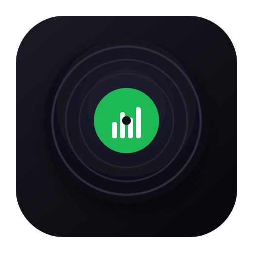

### Download

[](https://github.com/AnonymousV73X/WINDOWS-MUSIC-PLAYER/releases/latest)

> **Prefer a portable build?** Grab `NovaTune-2.0.3-portable.exe` from the [Releases page](https://github.com/AnonymousV73X/WINDOWS-MUSIC-PLAYER/releases) — no installer, just double-click and play.

</div>

---

## Why I Built NovaTune

I never really set out to code up a music player. I just wanted to listen to music on my laptop the way I do on my phone.

On Android, an app called **[Oto Music](https://play.google.com/store/apps/details?id=com.piyush.music)** quietly became the gold standard. Built largely by **one person** — Piyush Mamidwar — it crossed **2 million downloads** and held a steady **4.6-star rating** for years. It was *Material You to the core*: accent colors that flowed from your wallpaper, a beautiful full-screen lyrics view, gapless playback, a built-in tag editor, a folder blacklist so your ringtones never polluted your library, and synced lyrics pulled from **four different sources**. It was free. It was ad-free. It was feature-complete. It proved that a local music player could be beautiful and powerful at the same time. ([Android Police called it "the only one I kept."](https://www.androidpolice.com/i-tested-dozens-of-music-players-and-this-is-the-only-one-i-kept))

Then I looked at my Windows laptop. And Windows has a music player problem it has never solved.

- **Groove Music** was killed in 2017. Microsoft pulled its streaming service on October 2, 2017, pushed everyone to Spotify, and along the way [dropped the visualizations](https://forums.tomshardware.com/threads/what-happened-to-visualizations-in-groove-music.3802422) instead of re-licensing them. Gapless playback took *"years of crying and begging."* Even now, years after it was replaced, [users on Microsoft Q&A are still asking](https://learn.microsoft.com/en-us/answers/questions/4168983/any-way-to-get-back-old-groove-music-player) *"Is there any way to get back the old Groove Music player? The interface was way much better."*
- **The new Windows 11 Media Player** looks pretty, and then it betrays you. Users on r/Windows11 [report it locking up mid-song](https://www.reddit.com/r/Windows11/comments/1fnut0w/the_modern_media_player_in_windows_11_is_not_up), repeating the last 5 seconds of audio in a loop until you kill it from Task Manager. It's [slower to open than VLC and even the legacy WMP](https://windowsforum.com/threads/windows-11-media-player-11-2605-14-0-new-fixes-but-still-slower-than-legacy.426588). It routinely [can't detect music that's clearly on disk](https://www.reddit.com/r/windows/comments/sy779s/new_windows_11_media_player_wont_display_any_of). It [throws `0x80070005` when you try to create a playlist](https://www.elevenforum.com/t/cant-create-playlist-in-windows-11-media-player-app.30794) — and the community answer is literally *"switch to Foobar2000, it's free."* Worse, [songs silently disappear from your playlists](https://www.bleepingcomputer.com/forums/t/709061/songs-missing-on-windows-media-player-playlists) — sometimes 50% of them — and the player tells you it *"cannot find the file"* for files that are still sitting right there on your hard drive. And synced lyrics? Forget it.
- **Windows Media Player Legacy** is still there — as an *Optional Feature* you have to install manually. Microsoft's own Insider forum admits it ["still looks like it's from the 2000s"](https://techcommunity.microsoft.com/discussions/windowsinsiderprogram/windows-11-media-player-legacy-still-looks-like-it%E2%80%99s-from-the-2000s/4512415), its DRM services are [officially deprecated](https://learn.microsoft.com/en-us/windows/whats-new/deprecated-features), and on some installs it [refuses to open at all](https://www.reddit.com/r/WindowsHelp/comments/1p7isbs/is_this_common_with_windows_11_windows_media).

In short: Windows users are stuck choosing between a buggy modern app that lost the plot, a dead 2017 streaming husk, and a player frozen in 2000s amber. Meanwhile Android users have had Oto Music for years.

So I built NovaTune.

Synced lyrics from the open **[LRCLIB](https://lrclib.net)** database. A real 10-band parametric equalizer with 20 presets. Crossfade and gapless playback through a Web Audio API pipeline. A blazing fast library scanner with binary manifest decoding. Built-in **pure yt-dlp 320kbps Music Downloader & Discovery**, instant **LANBeam zero-cloud wireless file sharing**, tag editing, interactive vinyl animations with tonearm control, squiggly off-thread progress bars with customizable game-inspired scrubber heads, seamless Windows media integration, automatic updates, a self-healing library that finds moved files, and an AI-powered cover art engine that searches iTunes and Deezer when local art isn't found.

This is the music player Windows should have shipped. Since it didn't, I did.

---

## What is NovaTune

NovaTune is a **native Windows desktop music player** built with **Electron 28**, high-performance native modules (`better-sqlite3`, `sharp`, `node-taglib-sharp`, `node-id3`, `node-vibrant`, `electron-updater`), an integrated **yt-dlp** engine, and a custom **Web Audio API** mastering pipeline. It is single-instance, frameless, dark by default (with full Light Mode support), and integrates with Windows SMTC.

|                     |                                                                   |
| ------------------- | ----------------------------------------------------------------- |
| **App ID**          | `com.novatune.player`                                             |
| **Version**         | 2.0.3                                                             |
| **License**         | FOR SALE                                                          |
| **Platform**        | Windows x64 (NSIS installer + portable build)                     |
| **Aesthetic**       | Spotify-dark, Light theme, Material You dynamic palette           |
| **Library backend** | SQLite (WAL mode) + binary manifest fast-path                     |
| **Audio backend**   | Web Audio API + (optional) WASAPI exclusive mode                  |
| **Downloader**      | Integrated `yt-dlp` 320kbps engine (MP3 & M4A)                   |
| **Local Sharing**   | Native LANBeam integration (LAN Wi-Fi file transfer)              |
| **Auto-Updater**    | `electron-updater` (silent background download, one-click install)|

---

## Table of Contents

- [Why I Built NovaTune](#why-i-built-novatune--an-honest-story)
- [What is NovaTune](#what-is-novatune)
- [What's New](#whats-new)
- [Feature Highlights](#feature-highlights)
- [Home Screen & Custom Queues](#home-screen--custom-queues)
- [Discovery & yt-dlp Music Downloader](#discovery--yt-dlp-music-downloader)
- [LANBeam & Local Sharing](#lanbeam--local-sharing)
- [Batch Select & Multi-Track Operations](#batch-select--multi-track-operations)
- [Interactive Vinyl & Tonearm](#interactive-vinyl--tonearm)
- [The Squiggly Progress Bar & Scrubber Heads](#the-squiggly-progress-bar--scrubber-heads)
- [Audio Engine](#audio-engine)
- [Lyrics System](#lyrics-system)
- [Library & Metadata](#library--metadata)
- [Robust Cover Art Engine](#robust-cover-art-engine)
- [Self-Healing Library](#self-healing-library)
- [Playlists — Import & Export](#playlists--import--export)
- [Auto-Updater](#auto-updater)
- [Now Playing Overlay](#now-playing-overlay)
- [Theming & Accent Colors](#theming--accent-colors)
- [Windows Integration](#windows-integration)
- [Settings Reference](#settings-reference)
- [Keyboard Shortcuts & Commands](#keyboard-shortcuts--commands)
- [npm & CLI Commands](#npm--cli-commands)
- [Project Map](#project-map)
- [Tech Stack](#tech-stack)
- [Build From Source](#build-from-source)
- [Known Limitations & Quirks](#known-limitations--quirks)
- [Contact the Developer](#contact-the-developer)
- [Credits](#credits)
- [License](#license)

---

## What's New

### v2.0.3 (Latest)

- **Robust Cover Art Engine** — Binary magic-byte validation rejects SVG placeholders and corrupted images. When no local art is found, NovaTune automatically searches **iTunes** then **Deezer** and saves the result as a `.novaart.jpg` sidecar file. The abstract music-note icon is now truly a last resort.
- **Refill Cover Art** — New "Refill Cover Art" action in every track row's 3-dot context menu triggers an immediate per-song art search (local → online). Also available as a batch "Refill Thumbnails" button in Settings → Cover Art.
- **Library Sort Persistence** — Sort key (Title, Artist, Duration, Date Added, etc.) and sort direction now survive app restarts — written to both `localStorage` (instant, synchronous) and `settings.json` (persisted).
- **Numeric Library Sorting** — Duration, year, track number, bitrate, file size, and sample rate now sort numerically instead of lexicographically ("10:00" > "3:45" correctly now).
- **Sibling Cover Art Affinity Guard** — NovaTune no longer assigns a neighboring song's cover art to an unrelated track. Sibling art now requires album/artist matching and binary image validation.
- **Self-Healing Scan Folders** — On every settings load, NovaTune automatically drops scan folders that no longer exist on disk (removed drives, deleted paths), then saves the cleaned list back.

### v2.0.2

- **Custom Queue Builder** — Build and save named playlists of hand-picked tracks from your library. Saved queues appear on the Home screen as playable cards. Fully editable and deletable. Toggle off in Settings to restore the classic "Shuffle Library" button.
- **Home Screen** — Redesigned home with library stats, Recently Added, Recently Played panels, and your saved Custom Queues grid. The home hero shows total songs, playlists, and total library duration.
- **Playlist Import & Export** — Import M3U, M3U8, PLS, XSPF, and JSON playlist files; export any NovaTune playlist to M3U or M3U8. UTF-8 (M3U8) and latin1 (M3U) encoding handled automatically.
- **Playlist Export button** — 3-dot menu on playlist cards now includes "Export playlist."
- **Playlist Import button** — Toolbar in the Playlists view shows an import button when active.
- **Queue Source Badge** — The Play Queue header now shows a badge naming where the queue came from (album, artist, playlist, or custom queue name).
- **Scan Progress Bar** — A live progress bar overlays the library view during full rescans and quick scans — shows current folder and % completion.
- **Auto-Updater (OTA)** — NovaTune silently checks GitHub Releases on launch. When an update is downloaded, a toast prompts the user to restart and install. Progress bar in-app.
- **Help Page** — Dedicated "Help" section in the sidebar with feature guides, keyboard shortcut reference, and tips for lyrics, sharing, and updates.
- **ThumbHash Instant Placeholders** — Tracks show a blurred color-matched thumbnail placeholder (decoded from a ~40-byte ThumbHash stored in the DB) while the full-res image loads — eliminates blank squares.
- **Startup Section Memory** — NovaTune opens to whichever section you were last in. The startup section preference also lives in Settings.

### v2.0.1

- **EQ Animation Persistence** — The animated EQ icon on the playing track now persists when navigating between Album, Artist, and Playlist detail views.
- **Sort-By Dropdown** — Sort-by control in the toolbar; available in Library and Home sections.
- **Card Sort Mode** — Separate sort control for Albums, Artists, and Playlists cards: A→Z, Z→A, Most Songs, Fewest Songs, Newest First, Oldest First.
- **128px Thumbnail Atlas** — Thumbnail resolution upgraded from 96px → 128px for crisper art on 4K displays. One-time migration deletes old cached WebP files.
- **Album Art Fingerprint Cache** — Tracks from the same album reuse the same resolved cover art URL without re-resolution — eliminates redundant IPC calls per album.
- **SingleFlight Thumbnail Deduplication** — 50 visible rows requesting the same thumbnail becomes 1 IPC call. All callers wait for the same Promise.
- **Collage Regeneration** — Playlist cover collages are invalidated and regenerated when the track list changes. Layout version bump forces cache clear.
- **IDB-backed Thumbnail Cache** — Browser IndexedDB stores decoded thumbnail URLs across sessions so hot-reload (Ctrl+R) is instant.

---

## Feature Highlights

- **Pure yt-dlp High-Speed Audio Downloader** — High-speed download engine bundled with `yt-dlp.exe`. Supports crystal-clear 320kbps MP3s and original-quality M4A. One-click instant download abort/cancel that purges partial chunks, and automatic metadata enrichment and instant library hot-reload.
- **Discovery View** — Discover and stream tracks from YouTube Music, iTunes, and JioSaavn with automatic duplicate detection (prevents downloading songs already in your library). Paste a **Spotify link** directly into the search bar for instant matched lookup.
- **Tag Editor with Full ID3 & TagLib Sharp Support** — Comprehensive metadata editor (`node-id3` + `node-taglib-sharp`) for MP3, FLAC, M4A, OGG, and WAV. Edit title, artist, album, year, genre, track/disc numbers, and cover art on disk.
- **Track Properties Card** — Deep technical inspection of any track: container format, bitrate, sample rate, channels, file size, date added/modified, and absolute file path.
- **Share Card & LANBeam Wireless Hand-off** — 7 share targets: **LANBeam** (direct zero-cloud PC/phone file transfers with auto-install from GitHub and auto-detection), Copy File to clipboard, Show in Folder, Copy Name, WhatsApp, Telegram, and Email.
- **Batch Multi-Select in Library** — Mouse drag-to-lasso multiple tracks or press `Ctrl+A`. Triggers a floating action bar to batch-share via LANBeam or batch-delete.
- **Interactive Vinyl Record & Tonearm** — Realistic turntable visualization in the lyrics panel when no lyrics are available. Dynamic tonearm swings into place when playing and rests when paused, with click-to-play/pause on the vinyl.
- **Floating Scroll Pill Indicator** — Floating track preview chip while scrolling large music libraries or queue lists; click to jump directly to the playing song.
- **Customizable Progress Bar Scrubber Heads** — Choose between 7 scrubber styles: **Squiggly (Classic)**, **Boring (Straight line)**, **Amoeba**, **Snake**, **Pac-Man**, **Ant**, and **Firefly**. Runs on an `OffscreenCanvas` in a Web Worker — 60fps without loading the main thread.
- **Actions Menu Everywhere** — 3-dot context menu available on track rows across Music Library, Albums, Artists, Playlists (with in-menu "Remove from Playlist"), Play Queue, and Home. Includes: Play, Add to Playlist, Share, Edit Tags, Properties, Refill Cover Art, Delete.
- **Startup Section & Appearance Settings** — Choose which view NovaTune opens on startup (Library, Artists, Albums, Playlists, Home, Queue, Equalizer, or Help). Full Light Theme and Dark Theme support with adjustable interface scaling (100%–200%).
- **Quick Refresh (`Ctrl+R`) & Full Rescan (`Ctrl+F5`)** — Fast incremental updates (scans all configured music folders for new files) or comprehensive library rebuilding at your fingertips.
- **Binary Manifest Fast Path** — Ultra-fast library bootstrap with `ManifestDecoder`. Reads whole libraries in ~15 ms via compact ArrayBuffer decoding.
- **Predictive Audio & Metadata Prefetching** — Warms audio element, decodes album art, and prefetches online lyrics on track hover before clicking play.
- **Equal-Power Crossfade & Gapless Playback** — Web Audio mastering pipeline with 10-band parametric EQ and 20 presets.
- **Auto-Updater** — Silent OTA updates via `electron-updater`; downloads in background and prompts once ready.
- **Self-Healing Library** — Tracks whose files have moved are auto-relocated at playback time. Deleted scan folders are silently cleaned from settings.
- **Help Section** — Built-in help page with feature walkthroughs, all keyboard shortcuts, and tips — accessible from the sidebar.

---

## Home Screen & Custom Queues

The **Home** screen is your music command center:

- **Library Stats Hero**: Shows total song count, playlist count, and total library playtime at a glance.
- **Recently Added**: Up to 6 of your most recently scanned songs, one click to play.
- **Recently Played**: Your listening history since the last session.
- **Custom Queue Builder**: Create named queues of hand-picked tracks from your library. Saved queues appear as cards you can play, edit, or delete. Great for themed listening sessions — "Late Night Drive", "Workout", "90s Throwback" etc.
  - Toggle the Custom Queue feature off in Settings (Playback → Disable Custom Queue) to show a classic "Shuffle Library" button instead.

---

## Discovery & yt-dlp Music Downloader

NovaTune features a built-in **Music Downloader** powered by an integrated `yt-dlp` engine:

- **Multi-Source Discovery**: Search and explore across YouTube Music, iTunes, and JioSaavn.
- **Spotify Link Support**: Paste a Spotify track or album URL directly into the search bar — NovaTune resolves and matches it automatically.
- **Format Flexibility**: Toggle between **M4A** (instant download, native AAC stream) and **MP3** (high-bitrate 320kbps conversion) right from Settings.
- **Smart Duplicate Protection**: Checks incoming downloads against your library title, artist, and duration fingerprints. If the song already exists, NovaTune notifies you and avoids duplicate storage.
- **Clean Cancellation**: Instant abort button with circular progress indicator cleanly cancels in-progress downloads and cleans up temporary files.
- **Auto-Enrichment & Hot-Reload**: Automatically tags downloaded files with high-res cover art and ID3 metadata, immediately reloading the song into the live library index without requiring an app restart.

---

## LANBeam & Local Sharing

Every track row and batch selection integrates with **LANBeam** for zero-cloud file transfers:

- **Zero Configuration**: NovaTune auto-detects existing LANBeam installations on your PC. If missing, it can automatically fetch and install the latest release directly from GitHub.
- **Batch Transfer**: Select multiple songs in the library and send them all over LAN sequentially with progress feedback toasts.
- **Additional Share Targets**: Copy raw file, reveal in Explorer, copy formatted song name, or launch pre-populated share links in WhatsApp, Telegram, or Email.

---

## Batch Select & Multi-Track Operations

- **Drag-to-Lasso**: Click and drag across track rows to select multiple tracks.
- **Selection Shortcuts**: Press `Ctrl+A` to select all songs in the current view; `Escape` to dismiss the selection; `Delete` to remove all selected items in one confirmation.
- **Floating Action Bar**: Displays selected track counts with quick action buttons for **Share via LANBeam** and **Delete**.

---

## Interactive Vinyl & Tonearm

When lyrics are absent or loading, NovaTune displays an interactive vinyl turntable:

- **Animated Tonearm**: Realistic tonearm rests beside the record when playback is paused and smoothly swings onto the rotating vinyl grooves during playback.
- **Accent Theming**: The tonearm and vinyl center label are subtly tinted with the current theme accent color.
- **Direct Control**: Click directly on the spinning record to toggle play and pause.

---

## The Squiggly Progress Bar & Scrubber Heads

The progress bar runs on an `OffscreenCanvas` in a Web Worker, ensuring butter-smooth 60fps animations without loading the main thread.

In Settings under **Scrubber Head**, choose from 7 animated scrubber styles:

- **● Squiggly (Classic)** — Android AOSP-inspired undulating sine wave.
- **━ Boring** — Clean, straight progress bar for distraction-free listening.
- **🦠 Amoeba** — Organic morphing fluid thumb.
- **🐍 Snake** — Segmented slithering body following the playback trail.
- **ᗧ Pac-Man** — Animated chomping Pac-Man eating dot crumbs across the track timeline.
- **🐜 Ant** — Animated crawling ant along the progress trail.
- **✨ Firefly** — Glowing, pulsating firefly particle.

Each scrubber style also renders inside the **Now Playing Overlay** for a fully immersive full-screen experience.

---

## Audio Engine

NovaTune runs audio through a Web Audio API mastering chain:

```
HTMLAudioElement
  → MediaElementAudioSourceNode
  → [EQEngine: preampGain → 10× BiquadFilter chain]
  → GainNode (user volume)
  → DynamicsCompressorNode (mastering limiter)
  → AnalyserNode (visualizer)
  → GainNode (volume boost up to 2.0×)
  → AudioContext.destination
```

- **10-band parametric EQ**: 32 Hz to 16 kHz with 20 tuned presets and clipping headroom protection.
- **Volume Boost**: Up to 200% boost for quiet masters.
- **Safe Launch Volume**: Option to revert to a predefined safe volume (e.g. 50%) on launch or remember previous levels.
- **Equal-Power Crossfade**: Smooth equal-power crossfade between tracks (configurable duration 0–10s).
- **Duration Toggle**: Click the duration indicator in the player controls or overlay to switch between total track time (`3:45`) and remaining countdown (`-1:15`).

---

## Lyrics System

Lyrics in NovaTune are a 5-tier cascade:

1. **In-memory cache** (`Map<trackId, lyrics>`) — instant.
2. **SQLite-stored lyrics** — checks `lyricsPath` on disk first, then `syncedLyrics` / `plainLyrics` columns.
3. **Local `.lrc` sidecar** — replaces the audio file's extension with `.lrc` (case-insensitive).
4. **Embedded tag lyrics** — read from ID3v2 USLT/SYLT, Vorbis Comments `LYRICS`, iTunes `©lyr`, and APEv2 `LYRICS`.
5. **Online LRCLIB** — queried via LRCLIB APIs with duration matching.

When no lyrics are found, the **Interactive Vinyl & Tonearm** display takes over automatically.

Lyrics sync can be manually nudged ±1 second using the clock icon in the lyrics panel header.

---

## Library & Metadata

- **File Formats**: Supports 12 audio extensions (`.mp3, .flac, .wav, .ogg, .m4a, .aac, .wma, .opus, .ape, .wv, .tta, .mpc`).
- **Binary Manifest Fast Path**: High-speed bootloader deserializes tracks from a binary buffer in ~15 ms, bypassing slow iterative JSON parsing.
- **Exhaustive Multi-Tier Cover Art**: Embedded tags → `.novaart` sidecars → folder cover image files → WMP album art cache → sibling track art (with album/artist affinity check).
- **Tag Editing**: Write tags back to audio files via `node-id3` and `node-taglib-sharp`. Supports cover art replacement from file or data URI.
- **Library Sort Persistence**: Sort key and direction persist across restarts (stored in both localStorage and settings.json).
- **Numeric Sorting**: Duration, year, track number, bitrate, file size, and sample rate sort numerically, not lexicographically.
- **Quick Refresh scans ALL folders**: `Ctrl+R` quick refresh covers every folder in your Settings → Scan Folders list — not just the NovaTune downloads directory.

---

## Robust Cover Art Engine

NovaTune's cover art pipeline has been rebuilt from the ground up to never show you the wrong art:

**Validation Layer**: Every image candidate is validated against binary magic bytes (JPEG `FF D8 FF`, PNG `89 50 4E 47`, WebP, GIF, BMP). Files smaller than 1,500 bytes, SVG files, and XML payloads are rejected automatically — even if they're wrapped in a fake JPEG container.

**4-Step Resolution Chain** (for each track):
1. **Embedded art** — Extracted from ID3v2 `APIC`, FLAC `METADATA_BLOCK_PICTURE`, M4A `covr`, etc., validated.
2. **Sidecar file** — `.novaart.jpg` saved beside the audio file from previous online searches, validated.
3. **Filesystem search** — Scans the track's folder for `cover.jpg`, `folder.jpg`, `album.jpg`, `front.jpg`, `artwork.jpg`, and any image matching the audio filename — sorted by priority, validated.
4. **Online search** — Queries **iTunes Search API** then **Deezer API** using artist + title + album. Downloads and validates each candidate. Saves the first valid result as a `.novaart.jpg` sidecar for future fast-path resolution.

**Refill Cover Art**: The 3-dot menu on every track row includes a **"Refill Cover Art"** action — force-runs the full 4-step chain and updates the track in real time. Settings → Cover Art includes a **"Refill Thumbnails"** button for batch-refilling the entire library and a **"Re-search All Art"** button for a force-online sweep of every track.

---

## Self-Healing Library

NovaTune automatically repairs broken library state:

- **Moved File Detection**: When a track can't be opened at its recorded path, NovaTune searches the same directory and all configured scan folders for a file with matching audio fingerprint/name. If found, the database path is silently updated — no "file not found" errors.
- **Stale Scan Folder Cleanup**: On every settings load, folders that no longer exist on disk (deleted directories, removed external drives) are automatically pruned from the scan folder list.
- **Cover Art Validation**: Art that passed the old, loose validator but is actually an SVG icon is detected and re-resolved next time the track is displayed.

---

## Playlists — Import & Export

NovaTune supports full playlist interchange with other players:

**Import** (button in the Playlists toolbar):
- **M3U / M3U8** — Standard extended M3U with `#EXTINF` lines; latin1 or UTF-8.
- **PLS** — WinAmp PLS format.
- **XSPF** — XML Shareable Playlist Format.
- **JSON** — NovaTune native playlist format.

Imported playlists are matched against your library by file path, then by title/artist if the path doesn't match.

**Export** (3-dot menu on any playlist card):
- **M3U** — latin1, for maximum compatibility with legacy players.
- **M3U8** — UTF-8, for non-ASCII track collections.

---

## Auto-Updater

NovaTune ships with a built-in OTA updater powered by `electron-updater`:

- **Silent background check** on every launch — queries GitHub Releases for a newer version.
- **Background download** — the update installs silently while you listen.
- **One-click install** — a toast notification prompts you to restart when the download completes. Progress is shown with a live progress bar.
- **No action required** — if you ignore the toast, NovaTune applies the update on the next restart.

---

## Now Playing Overlay

Press **F11** (or the expand button in the player) to open the full-screen **Now Playing Overlay**:

- Full-window album art backdrop with dynamic blur and color extraction.
- Synchronized scrolling lyrics or Interactive Vinyl when no lyrics exist.
- Full scrubber bar with your chosen scrubber head animation (all 7 styles supported).
- EQ bars animation on the track title.
- Press **F11** or **Escape** to close.

---

## Theming & Accent Colors

| Setting | Options |
| --- | --- |
| **Theme Mode** | Dark (default), Light |
| **Accent Presets** | Spotify Green, Sky Blue, Orange, Yellow, Mint, Pink, Red, Ice |
| **Custom Color** | Hex color picker — any color you want |
| **Dynamic Accent** | Extracts dominant color from active album art via `node-vibrant` |
| **Interface Scaling** | 100% – 200% (high-DPI support) |

---

## Windows Integration

- **SMTC (System Media Transport Controls)** — Full Now Playing metadata (title, artist, album, cover art) exposed to Windows. Media keys on your keyboard and taskbar playback buttons work system-wide.
- **Thumbnail Toolbar** — Prev / Play-Pause / Next buttons appear directly in the Windows taskbar thumbnail preview.
- **Windows Notifications** — Track change and update toasts use native Windows toast notifications.
- **Single Instance** — Launching NovaTune when it's already running focuses the existing window instead of opening a second one.
- **File Association** — Pass an audio file path as a CLI argument to open and play it instantly (`electron . "C:\Music\song.mp3"`).

---

## Settings Reference

| Section | Setting | Options / Values | Description |
| --- | --- | --- | --- |
| **Playback** | Shuffle by default | Toggle | Automatically activates shuffle when queuing tracks. |
| | Show lyrics panel | Toggle | Automatically opens lyrics panel when lyrics exist. |
| | Hardware acceleration | Toggle | Enables or disables Chromium GPU acceleration. |
| | Expanded sidebar | Toggle | Shows expanded sidebar layout on smaller screens. |
| | Disable Custom Queue | Toggle | Replaces Custom Queue button on Home with Shuffle & Play. |
| | Volume bar | `On Hover` / `Visible` | Show volume slider on hover or keep visible. |
| | Download format | `MP3` (320k) / `M4A` | Select default audio container for music downloads. |
| | Side menu (compact) | `On Hover` / `Always Visible` / `Icon` | Floating nav behavior for narrow viewports. |
| | Volume on launch | `Save & Restore` / `Safe Volume` | Restore last volume or reset to a safe level. |
| | Safe volume level | 0% – 100% | Configurable safe volume threshold. |
| | Volume Boost | 100% – 200% | Master digital boost. |
| **Cover Art** | Refill Thumbnails | Button | Batch-scan entire library for missing/invalid art, search online for each. |
| | Re-search All Art | Button | Force online search (iTunes + Deezer) for every track in the library. |
| **Accent Colour** | Presets | 8 accent swatches | Spotify Green, Sky Blue, Orange, Yellow, Mint, Pink, Red, Ice. |
| | Custom Color | Hex color picker | Custom interface accent color. |
| | Dynamic Accent | Toggle | Dynamically extracts colors from active album art using `node-vibrant`. |
| **Startup & Appearance** | Startup section | `Music Library`, `Artists`, `Albums`, `Playlists`, `Home`, `Play Queue`, `Equalizer`, `Help` | Default screen loaded on app launch. |
| | Theme mode | `Dark (Default)` / `Light` | Full light and dark theme engine. |
| | Interface scaling | 100% – 200% | High-DPI scaling adjustment. |
| **Font** | Interface font | `Outfit` / `Figtree` | Select preferred typography. |
| **Scrubber Head** | Scrubber style | `Squiggly`, `Boring`, `Amoeba`, `Snake`, `Pac-Man`, `Ant`, `Firefly` | Change seek bar thumb character. |
| **Card Sorting** | Card sort mode | `A → Z`, `Z → A`, `Most Songs`, `Fewest Songs`, `Newest First`, `Oldest First` | Sorting order for Albums, Artists, and Playlists. |
| **Library** | Scan Folders | Add / Remove / Refresh | Manage library scan directories. |

---

## Keyboard Shortcuts & Commands

### Playback & Volume

| Command / Shortcut | Action | Scope / Context |
| --- | --- | --- |
| `Space` | Play / Pause | Global |
| `N` | Next track | Global |
| `P` | Previous track | Global |
| `↑` / `↓` | Volume Up / Down (±5%) | Global (unfocused) |
| `M` | Mute / Unmute toggle | Global |
| `→` / `←` | Seek forward / backward ±5 seconds | Global |
| `Shift + →` | Jump to Next track | Global |
| `Shift + ←` | Jump to Previous track | Global |
| `S` | Toggle Shuffle mode | Global |
| `1` or `R` | Toggle Repeat One track | Global |
| `0` or `O` | Toggle Repeat All tracks | Global |
| `L` | Like / Favorite current track | Global |
| `T` | Open Tag Editor for active track | Global |
| `MediaPlayPause` | Media Key: Play / Pause | System-wide / SMTC |
| `MediaNextTrack` | Media Key: Next Track | System-wide / SMTC |
| `MediaPrevTrack` | Media Key: Previous Track | System-wide / SMTC |

### Navigation, View & Search

| Command / Shortcut | Action | Scope / Context |
| --- | --- | --- |
| `Ctrl + F` or `/` | Focus instant search box | Global (focuses & highlights text) |
| `Ctrl + P` | Open "Add to Playlist" menu for playing track | Global |
| `Ctrl + L` | Switch theme to Light Mode | Global |
| `Ctrl + D` | Switch theme to Dark Mode | Global |
| `Ctrl + R` | Quick Refresh library (picks up new files only, all scan folders) | Global |
| `Ctrl + F5` | Full Rescan library (reindexes entire collection) | Global |
| `F11` | Open / Close full-screen Now Playing overlay | Global |
| `PageUp` / `PageDown` | Fast scroll track list up / down | Library view |
| `Shift + ↑` / `Shift + ↓` | Scroll track list up / down | Library view |
| `Escape` | Dismiss modal dialog, overlay, or clear search box | Global |

### Batch Selection & Dialogs

| Command / Shortcut | Action | Scope / Context |
| --- | --- | --- |
| `Ctrl + A` | Select all tracks | Music Library |
| `Click + Drag` | Lasso-select range of tracks | Music Library |
| `Delete` | Batch delete all selected tracks | Music Library (when tracks selected) |
| `Escape` | Clear current batch selection | Music Library (when tracks selected) |
| `Enter` | Submit rename / confirm modal action | Dialogs & inputs |

> **Note:** All single-character hotkeys are guarded and suppressed when typing inside inputs, textareas, or tag editing fields.

---

## npm & CLI Commands

### Development & Build Scripts

| Command | Description |
| --- | --- |
| `npm run build:main` | Bundles Electron main process with `esbuild` (`esbuild.main.config.js`). |
| `npm start` | Builds main process bundle and launches Electron. |
| `npm run dev` | Launches Electron directly with current files without rebuilding bundle. |
| `npm run build` | Compiles main bundle and builds the production NSIS Windows installer (`.exe`). |
| `npm run build:portable` | Compiles main bundle and creates a zero-install portable Windows executable. |
| `npm test` | Runs Jest test suite (`jest NovaTune.Tests/`). |
| `npm run zip` | Packages distribution binaries into archives (`zip.js`). |

### CLI Launch Arguments

| Flag | Example | Description |
| --- | --- | --- |
| `<file_path>` | `electron . "C:\Music\song.mp3"` | Direct launch and play of an audio file via Windows file association or CLI. |
| `--dev` | `electron . --dev` | Launches Electron with DevTools automatically opened. |
| `--accent-color=<hex>` | `electron . --accent-color=#00bfff` | Overrides the starting accent color at launch. |

---

## Project Map

```
NovaTune/
├── main/
│   ├── main.js                  — App entry, window creation, SMTC bridge
│   ├── ipc.js                   — All IPC handlers (library, cover art, settings, playlists, downloads)
│   ├── fileScanner.js           — Recursive audio file scanner
│   ├── metadataReader.js        — music-metadata + taglib extraction
│   ├── metadataWorker.js        — Worker pool for parallel metadata reads
│   ├── metadataWorkerThread.js  — Worker thread implementation
│   ├── coverArt.js              — Cover art resolution pipeline
│   ├── downloadEngine.js        — yt-dlp download + enrichment engine
│   ├── manifest.js              — Binary manifest writer (fast-path cache)
│   ├── manifestIPC.js           — Manifest IPC surface
│   ├── manifestReader.js        — Binary manifest reader
│   ├── smtc.js                  — Windows System Media Transport Controls bridge
│   ├── windowManager.js         — Window state persistence
│   ├── fileLogger.js            — Session log file writer
│   └── preload.js               — Secure IPC bridge (contextBridge)
├── renderer/
│   ├── renderer.js              — Main renderer (~18k lines): all UI, state, views
│   ├── index.html               — App shell HTML
│   ├── audio/
│   │   ├── AudioEngine.js       — Web Audio API pipeline
│   │   ├── EQEngine.js          — 10-band parametric EQ
│   │   ├── Crossfader.js        — Equal-power crossfade
│   │   └── Visualizer.js        — EQ bar visualizer
│   ├── ui/
│   │   ├── DiscoveryView.js     — Music discovery + download UI
│   │   ├── LibraryView.js       — Virtual-scrolled library list
│   │   ├── LyricsPanel.js       — Synced/plain lyrics + vinyl display
│   │   ├── NowPlayingOverlay.js — Full-screen overlay
│   │   ├── PlayerControls.js    — Bottom player bar
│   │   └── Sidebar.js           — Navigation sidebar
│   ├── services/
│   │   ├── ManifestDecoder.js   — Binary manifest ArrayBuffer decoder
│   │   ├── LibraryIndex.js      — In-memory library index
│   │   ├── LyricsService.js     — Lyrics fetch + cache
│   │   ├── MetadataService.js   — Renderer-side metadata reads
│   │   ├── PlaylistManager.js   — Playlist CRUD
│   │   └── SettingsService.js   — Settings read/write
│   ├── styles/
│   │   ├── main.css             — Core styles
│   │   ├── components.css       — Component-level styles
│   │   └── overlay.css          — Now Playing overlay styles
│   └── fonts/                   — Bundled Outfit & Figtree font faces
├── assets/icons/                — App icons, tray icon, thumbar button icons
├── screenshots/                 — UI screenshots for README
├── bin/
│   └── yt-dlp.exe               — Bundled yt-dlp binary
├── data/                        — User data: settings.json, playlists/, window-state.json
├── scripts/                     — Dev/build/test helper scripts
└── NovaTune.Tests/              — Jest test suite
```

---

## Tech Stack

### Runtime & Core

- **Shell**: Electron 28
- **Audio Engine**: Web Audio API (`AudioContext`, `BiquadFilterNode`, `DynamicsCompressorNode`, `AnalyserNode`)
- **Database**: SQLite (`better-sqlite3`, WAL journal mode)
- **Metadata**: `music-metadata`, `node-id3`, `node-taglib-sharp`
- **Image Processing**: `sharp` (WebP generation & resizing), `node-vibrant` (color extraction)
- **Downloader**: Bundled `yt-dlp.exe`
- **Updater**: `electron-updater`
- **Startup Accelerator**: `v8-compile-cache`
- **Bundler**: `esbuild`

### Build

- **Packager**: `electron-builder` (NSIS installer & portable Windows builds)

---

## Build From Source

### Prerequisites

- **Node.js 18+**
- **npm 9+**
- **Windows 10 / 11**

### Setup & Run

```bash
# Clone the repository
git clone https://github.com/AnonymousV73X/WINDOWS-MUSIC-PLAYER.git NovaTune
cd NovaTune

# Install dependencies
npm install

# Run in development mode (builds main bundle with esbuild and starts Electron)
npm start
```

### Compile Installer & Portable Executables

```bash
# Build production NSIS installer
npm run build

# Build standalone portable executable
npm run build:portable
```

---

## Screenshots

<div align="center">

| Home | Library |
|------|---------|
| 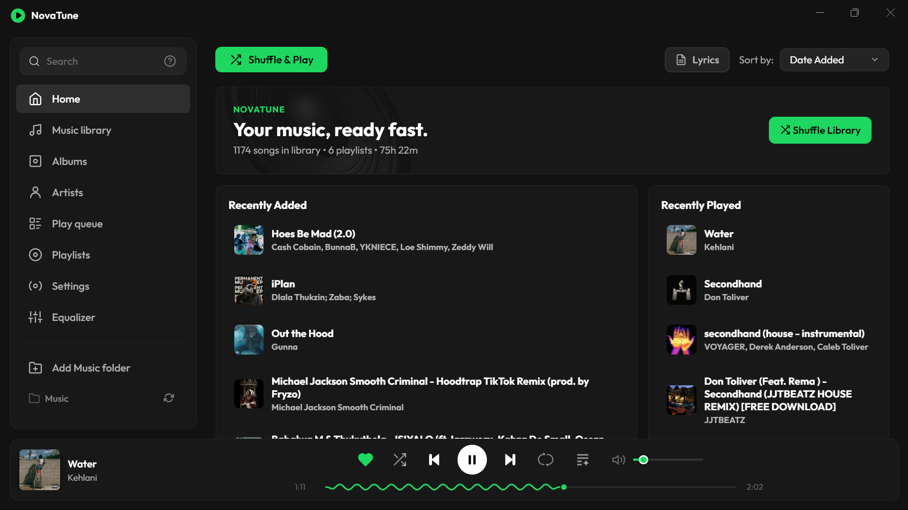 | 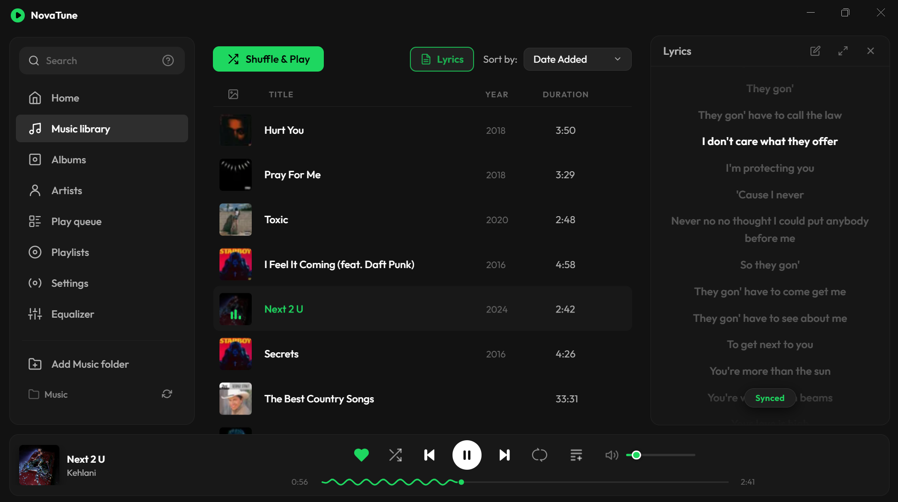 |

| Now Playing Overlay | Lyrics |
|--------------------|--------|
| 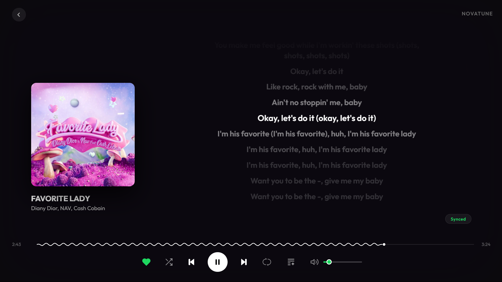 | 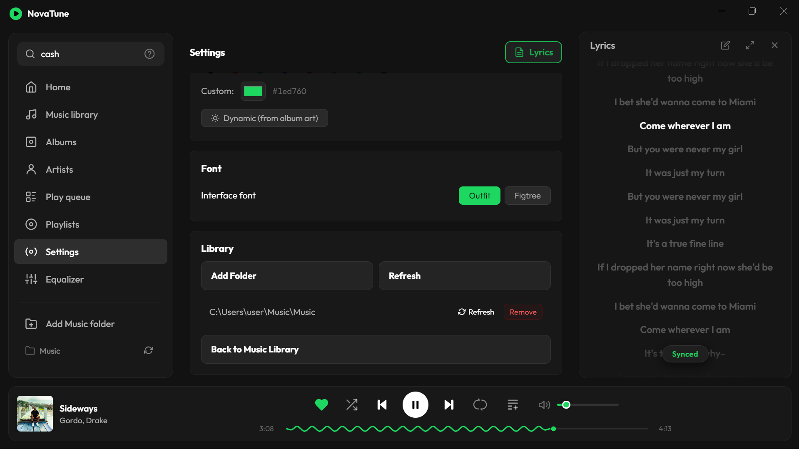 |

| Albums | Artists |
|--------|---------|
| 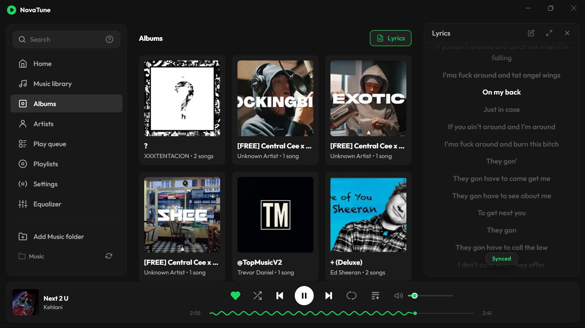 | 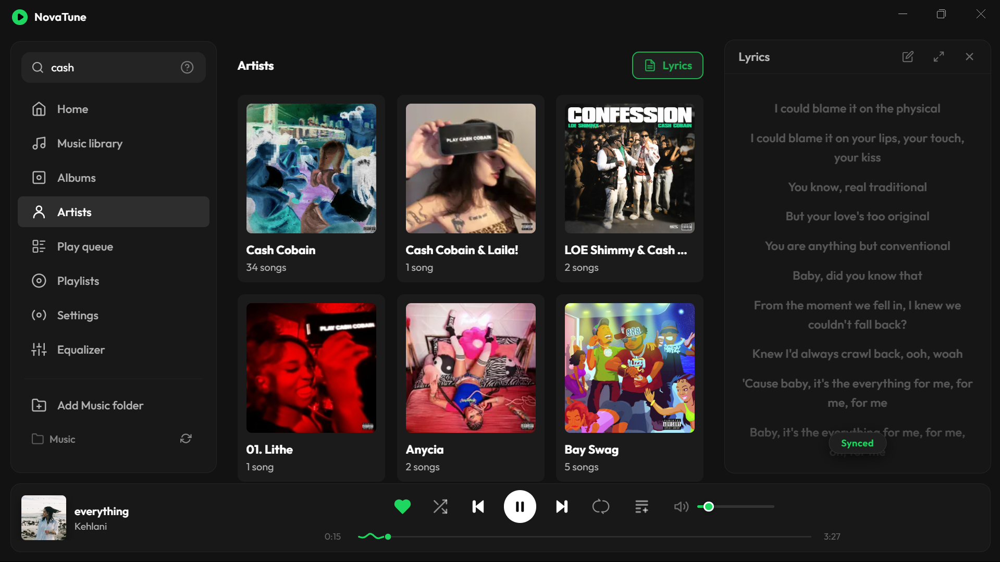 |

| Equalizer | Settings |
|-----------|----------|
| 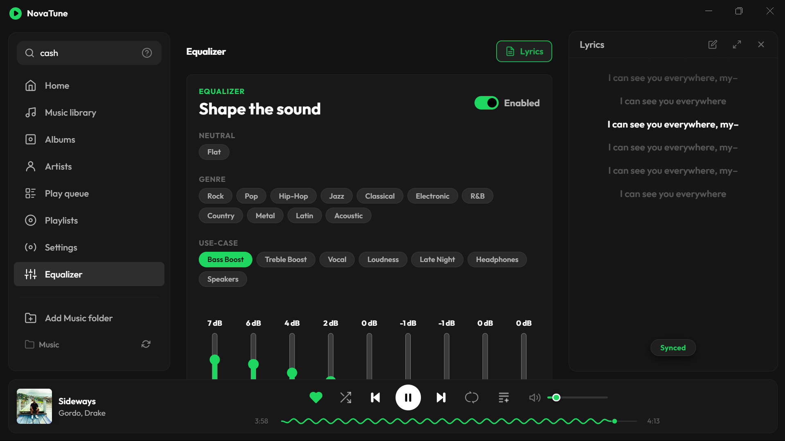 | 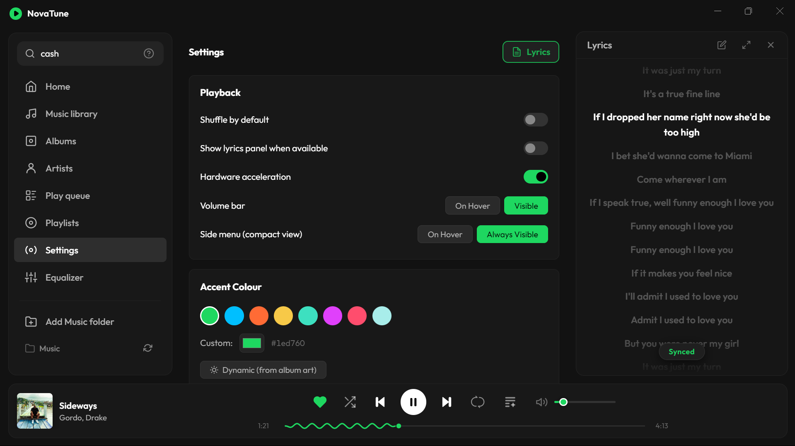 |

| Queue | SMTC |
|-------|------|
| 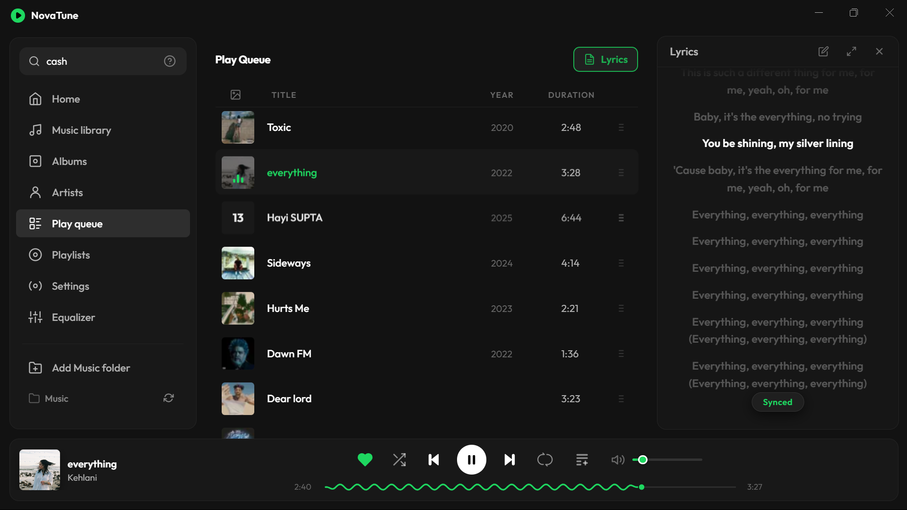 | 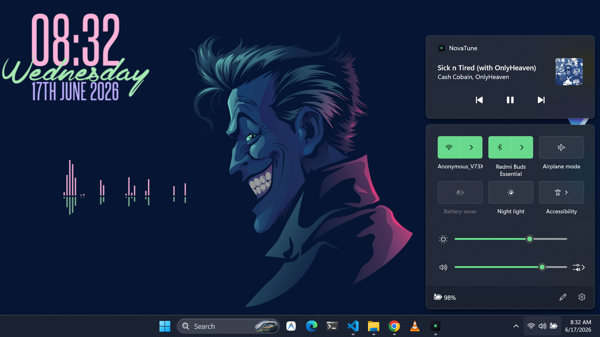 |

</div>

---

## Known Limitations & Quirks

This is v2.0.3 — a few notes:

- **Crossfade engine is implemented** in `Crossfader.js` and gapless playback is fully functional.
- **Tray icon assets exist** in `assets/icons/tray.png` for future system tray minimization support.
- **M3U playlist export** uses `latin1` for legacy compatibility, while `M3U8` provides UTF-8 for non-ASCII track collections.
- **Online cover art search** (iTunes/Deezer) requires an active internet connection. Offline mode falls back gracefully to local art or the abstract placeholder.
- **Self-healing path search** is best-effort: if a file has moved to an entirely different drive or folder not in the scan list, it may not be found automatically — adding the new folder via Settings → Scan Folders resolves this.

---

## Contact the Developer

Have questions, feedback, or need support? Reach out via WhatsApp, Telegram, or GitHub:

<div align="center">

[](https://wa.me/254741091123)
[](https://t.me/anonymous_V73X_1)
[](https://github.com/AnonymousV73X/WINDOWS-MUSIC-PLAYER/issues)

</div>

---

## Credits

NovaTune stands on the shoulders of giants:

- **[Oto Music](https://play.google.com/store/apps/details?id=com.piyush.music)** by Piyush Mamidwar — the inspiration for local music playback done right.
- **[LRCLIB](https://lrclib.net)** — the open synced-lyrics database powering NovaTune.
- **[music-metadata](https://github.com/Borewit/music-metadata)**, **[node-id3](https://github.com/Zazama/node-id3)**, & **[node-taglib-sharp](https://github.com/nickvidal/node-taglib-sharp)** for metadata reading and writing.
- **[yt-dlp](https://github.com/yt-dlp/yt-dlp)** for high-quality audio downloads and extraction.
- **[better-sqlite3](https://github.com/WiseLibs/better-sqlite3)** & **[sharp](https://sharp.pixelplumbing.com/)** for high-performance database queries and image transforms.
- **[electron-updater](https://www.electron.build/auto-update)** for seamless OTA updates.
- **[node-vibrant](https://github.com/Vibrant-Colors/node-vibrant)** for dynamic accent color extraction from album art.

---

## License

FOR SALE — see [LICENSE](./LICENSE) for details.

© 2026 NovaTune. All rights reserved.

<div align="center">

**NovaTune v2.0.3 • Made with love for music lovers**

</div>
